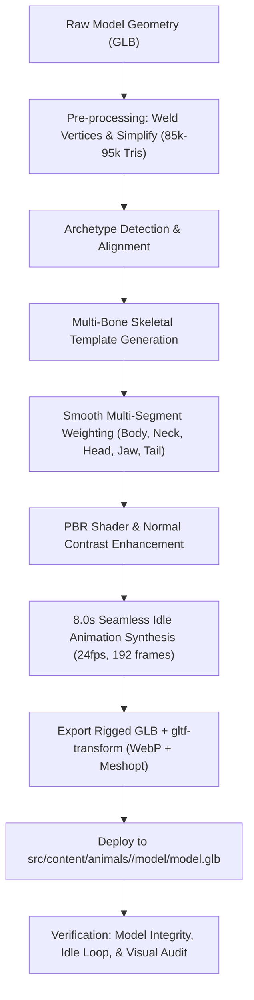

# Design Spec: Meshy-Driven Prehistoric Animal Model & Rig Optimization

- **Date**: 2026-10-19
- **Status**: Approved (Iterative Direct Execution)
- **Scope**: Tiered Optimization Strategy across 50 museum animals, prioritizing 4 Pioneer Archetypes:
  1. `theropod_biped`: **Tyrannosaurus Rex** (`tyrannosaurus-rex`)
  2. `ceratopsian_quadruped`: **Triceratops** (`triceratops`)
  3. `mammalian_quadruped`: **Smilodon** (`smilodon`)
  4. `marine_streamlined`: **Mosasaurus** (`mosasaurus`)

---

## 1. Background & Problem

The Prehistoric Animal Museum hosts 50 animated prehistoric species. While animals 1–18 were imported from legacy sources and 19–50 used early Meshy-6 batches with standard 3-bone procedural rigs (`Body`, `Head`, `Tail`), several visual limitations exist:
1. **Rigid Facial/Jaw Structure**: Heads rotate as a monolithic rigid block; mouths remain permanently open or shut, lacking respiratory relaxation and living presence.
2. **Monolithic Body Skeletons**: 3-bone rigs lack neck articulation and multi-segment spinal/tail wave decay, producing robotic or stiff motions on large species.
3. **PBR Surface Artifacts**: Raw generative outputs from Meshy can exhibit baked lighting/shadow artifacts, uniform surface roughness, and flat normal detailing in critical areas (scales, bone horns, skin folds).
4. **Archetype Mismatch**: Quadruped mammals, bipedal theropods, armored ceratopsians, and marine reptiles have distinct locomotive and postural mechanics that require specialized bone and deformation templates.

This specification details the end-to-end upgrade of the procedural rigging, animation, and material enhancement pipeline to support archetype-aware multi-bone rigs, jaw articulation, PBR shader enhancement, and automated web-optimized delivery.

---

## 2. Architecture & Pipeline

---

## 3. Archetype Skeletal Templates

The upgraded rigger (`tools/rig_and_animate_meshy.py`) introduces 4 distinct skeletal configurations:

### 3.1 `theropod_biped` (e.g., Tyrannosaurus Rex)
- **Bones**:
  - `Body` (Root): Centered at pelvic pivot $(0, 0, \text{hip\_z})$. Governs deep diaphragmatic breathing:
    - Width ($X$): $\pm 2.0\%$ (2 cycles)
    - Height ($Z$): $\pm 1.2\%$ (2 cycles)
    - Slight forward/backward shift ($Y$): $\pm 0.008\text{m}$.
  - `Neck`: Extends from chest anterior ($Y \approx 50\%$) to skull base ($Y \approx 72\%$). Subtle counter-sway.
  - `Head`: Extends from skull base to snout tip ($Y = \text{max\_y}$). Yaw $\pm 4.5^\circ$, Pitch $\pm 2.2^\circ$.
  - `Jaw`: Hinge at skull posterior base, angled forward through lower $40\%$ of skull height.
    - Synchronized respiration drop: Rotates pitch downwards by $2.0^\circ \sim 3.5^\circ$ during inhalation peak (Frames 48, 144), gently closes to resting position during exhalation.
  - `Tail_Base` & `Tail_Tip`: Dual-segment caudal chain. Sine-wave lateral sway ($\pm 5.5^\circ$ base, $\pm 8.5^\circ$ tip with phase delay $\Delta \phi = 45^\circ$).

### 3.2 `ceratopsian_quadruped` (e.g., Triceratops)
- **Bones**:
  - `Body`: Broad quadruped thoracic root. Lateral rib expansion $\pm 2.2\%$, vertical weight sway $\pm 0.8\%$.
  - `Neck_Frill`: Accommodates the prominent neck frill, preserving rigid skull-frill anatomy while articulating against the shoulders.
  - `Head` & `Jaw`: Low-slung browsing angle. Snout nod $\pm 1.8^\circ$, beak/jaw micro-chewing relaxation.
  - `Tail_Base` & `Tail_Tip`: Short, heavy stabilizing tail motion.

### 3.3 `mammalian_quadruped` (e.g., Smilodon)
- **Bones**:
  - `Body`: Flexible feline thoracic/lumbar spine. Dynamic breathing with slight pelvic dip.
  - `Neck`: High-dexterity cervical spine curve.
  - `Head`: Alert predatory orientation.
  - `Jaw`: Specialized saber-tooth clearance. Jaw pivots cleanly around mandibular fossa without stretching the upper canines.
  - `Tail`: Compact expressive twitch/sway.

### 3.4 `marine_streamlined` (e.g., Mosasaurus)
- **Bones**:
  - `Body`: Neutral buoyancy floating center.
  - `Spine_Mid` & `Spine_Rear`: Fluid lateral sinusoidal wave propagation along the axial skeleton.
  - `Head` & `Jaw`: Hydrodynamic cruising profile with subtle billow respiration.
  - `Tail_Base` & `Fluke`: Dual caudal fins with $3\times$ wave amplitude and $90^\circ$ phase lag for natural swimming rhythm.

---

## 4. Automatic Jaw Detection & Smooth Weighting

To articulate the jaw without manual vertex group authoring:
1. **Bounding Region**:
   - The head volume spans $Y \in [Y_{\text{neck\_end}}, Y_{\text{max}}]$.
   - The lower jaw volume is bounded by $Z \le Z_{\text{skull\_center}} - 0.05 \times H_{\text{head}}$ and $Y \ge Y_{\text{jaw\_hinge}}$.
2. **Weight Assignment**:
   - Vertices in the upper cranial vault and horns/canines receive $100\%$ `Head` bone influence.
   - Vertices in the mandibular ramus receive weighted `Jaw` bone influence ($85\%\sim100\%$).
   - The soft-tissue mouth corner and throat region receive a smooth 5-stage cosine blend between `Head`, `Jaw`, and `Neck`, preventing tearing or mesh collapse during jaw motion.

---

## 5. Material & PBR Enhancement

In the Blender pipeline:
1. **De-baking Artifacts**:
   - Analyze BaseColor brightness histograms. Apply non-linear contrast curves to lift over-occluded crevices while preserving natural pigment saturation.
2. **Normal Map Micro-detail**:
   - Combine existing normal maps with a high-frequency procedural micro-scale/dermal bump layer ($0.08$ blend strength) to ensure sharp specular highlights even at close inspection.
3. **Roughness Stratification**:
   - Differentiate horn/claw/teeth areas (low roughness $0.25\sim0.35$ for glossy keratine) from dry scaled/leathery skin (roughness $0.65\sim0.80$).

---

## 6. Compression & Production Standard

- **Triangle Budget**: $85,000 \sim 95,000$ triangles.
- **Textures**: 2K WebP encoded with near-lossless compression (quality 85).
- **Geometry Compression**: Draco / Meshopt quantized with `gltf-transform`.
- **Target File Size**: $\le 2.50\text{ MB}$ per asset.
- **Animation Format**: Single seamless `Idle` clip, exactly 192 frames at 24.0 fps (8.00 s), frame 192 keyframes identical to frame 0 for zero-drift infinite looping.

---

## 7. Rollout & Verification Plan

1. **Phase 1**: Upgrade `tools/rig_and_animate_meshy.py` with multi-bone archetypes, automatic jaw detection, and enhanced shader processing.
2. **Phase 2**: Process the 4 Pioneer Archetypes (`tyrannosaurus-rex`, `triceratops`, `smilodon`, `mosasaurus`).
3. **Phase 3**: Verify GLB size, animations, mesh integrity, and run `npx tsx tools/audit-animal-integration.ts`.
4. **Phase 4**: Test production web viewer compatibility and commit.
